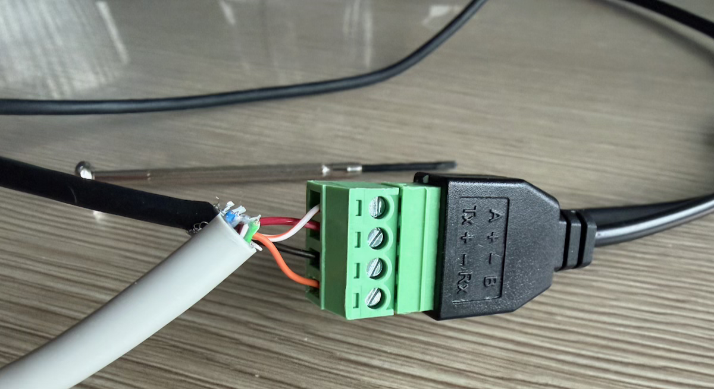

## Intro

For a couple of months, I have had a different solar inverter due to additional
solar panels that were added to the roof. As I'm very interested in knowing how
much energy those panels produce, I'm always looking for ways to extract that
data.

With the previous inverter, I could query a PHP page to know how much power was
currently being generated and how much energy the current day had yielded so
far. No (installer) accounts, no cloud, no online web portals.

With this new Huawei SUN2000 inverter that replaced the "old" one, things aren't
as easy anymore. The inverter luckily came with an included WiFi dongle called
the "SDongleA-05" and while it does work, you're tied to your data being
uploaded to ~~China~~ Huawei's cloud. To get some insight into your production,
you have to install their app, create an account and to top it off, you get data
that is multiple minutes old, if not missing entirely. Not ideal. This is why I
was looking into another way of obtaining the data the day after the
installation was complete.

### The Modbus protocol

It turns out, it's possible to read out the inverter using the
[Modbus](https://en.wikipedia.org/wiki/Modbus) protocol. In short, this involves
reading a given amount of registers located at specific addresses that contain
the requested data. Every register has a size of 16 bits and can be interpreted
depending on the context: as an unsigned or signed 16-bit integer, as a part of
a 32-bit integer, as a bit pattern, as two ASCII characters, and so on.

| Description            | Address | Type   | Quantity | Unit    | Gain |
| ---------------------- | ------- | ------ | -------- | ------- | ---- |
| Serial number          | 30015   | String | 10       | &ndash; | 1    |
| Number of PV strings   | 30071   | u16    | 1        | &ndash; | 1    |
| PV1 voltage            | 32016   | i16    | 1        | V       | 10   |
| Inverter's temperature | 32087   | u16    | 1        | &deg;C  | 1    |
| Current power          | 32080   | i32    | 2        | kW      | 1000 |

The table above is an excerpt from the documentation Huawei provides. For
example, to get the voltage of the first PV string, you would have to query the
address `32016`. The response would represent a signed 16-bit value that you
would have to divide by its gain, 10, to get the actual value in volts.

Likewise, getting the current power involves querying **two** addresses: `32080`
and `32081`. This is necessary because the current power is denoted by a signed
32-bit value which spans two registers. After getting the values and combining
them (using a left bit shift and a bitwise OR), you have to divide the result by
1000 to get the current power in kilowatts.

### Dongle issues

I implemented this using the
[modbus-serial](https://www.npmjs.com/package/modbus-serial) package for Node.js
which allowed me to query the inverter over TCP as my server isn't near the
inverter. While this worked, I still faced issues, however. Huawei seems to
attach little value to the fact that you can read the dongle yourself.
Sometimes, I would have data gaps of more than 45 minutes even though I queried
the device every 5 seconds.

According to a quick search online, this is a known limitation &ndash; one that
especially appears to arise when you block all outgoing communication from the
inverter to the outside world in your firewall. It's as if the dongle panics
when it cannot "phone home" anymore, after which it starts to drop a lot of
requests.

## Elfin EW11

Luckily, I stumbled upon a great GitHub
[repository](https://github.com/wlcrs/huawei_solar/wiki) that suggested buying
an [Elfin EW11](http://www.hi-flying.com/elfin-ew10-elfin-ew11) for a smoother
experience. This device performs basically the same task as the Huawei dongle,
but offers more flexibility and, hopefully, more stability.

While the "OG dongle" is just to be plugged in into the inverter's USB port,
this little device accepts four wires. You have to feed it some power (DC&minus;
and DC&plus;) and two signal lines (A and B) that will be used as data
transmission wires to connect to the inverter's COM port. In other words,
basic [RS-485](https://en.wikipedia.org/wiki/RS-485).

### Creating the cable

#### Powering the device

Getting the device powered is the easy part. The Huawei SUN2000 inverter has a
USB port (type A connector) which is unused after removing the official dongle.
It should provide 5 V at 1 A which is enough for the EW11, which has a voltage
input ranging from 5 to 36 V; as long as it's at least 5 W.

I've cut an old USB cable and split the wires to separate the power, the red
wire being the positive wire and the black one the negative.

#### Making communication possible

Next, another cable had to be sacrificed. I bought a cheap Ethernet cable
although I made sure it had twisted pairs and was foiled (shielded). As the communication
with the inverter is serial and the AC wire runs next to it, the whole thing may
be quite vulnerable to
[EMI](https://en.wikipedia.org/wiki/Electromagnetic_interference). I'm looking for
stability so I wasn't keen on trying my luck.

I cut a piece of around 20 cm, stripped both ends, and chose the orange/white
twisted pair as it resembles the colour of the sun the most &ndash; hey, it's
the little things in life. 

As those tiny wires are so fragile, I brought up my totally non-existing
soldering skills &ndash; I never learned it properly anywhere &ndash; and made
the ends of the wires a bit more sturdy by covering them with solder.

Afterwards, I detached the inverter's signal cable connector from its COM port
and wired it up. Port 2 and 4 were according to the manual the ports to use (see
table below, which contains an excerpt of the pin layout), even though I think I
could've also used 1 and 3. The order between the two wires and ports doesn't
matter _right now_ as long as you remain consistent later on.

| Pin | Definition | Function                                 | Description                                                                      |
| --- | ---------- | ---------------------------------------- | -------------------------------------------------------------------------------- |
| 1   | 485A1-1    | RS485A, RS485 differential signal&plus;  | Used to cascade inverters or connect to the RS485 signal port on the SmartLogger |
| 2   | 485A1-2    | RS485A, RS485 differential signal&plus;  | Used to cascade inverters or connect to the RS485 signal port on the SmartLogger |
| 3   | 485B1-1    | RS485B, RS485 differential signal&minus; | Used to cascade inverters or connect to the RS485 signal port on the SmartLogger |
| 4   | 485B1-2    | RS485B, RS485 differential signal&minus; | Used to cascade inverters or connect to the RS485 signal port on the SmartLogger |

Once everything was put back together, I wanted to make sure I didn't make any
mistakes. At the other side of the signal cable connector, the end that goes
into the inverter's COM port, I could insert one of my multimeter's probes. The
other I held to the wire itself. Putting my multimeter in continuity mode, I was
able to verify the connections were solid!

#### Finalising the cable

Finally, everything could be wired to the EW11's screw terminals. Now, it was
important to not swap the twisted pair. The orange wire was inserted into port 4
whichs means it needed to go to the B terminal (or negative signal), according
to the manual/table above. The white/orange striped wire that went into port 2
needed to go to the A terminal (or positive signal).

All that remained was screwing the positive and negative power wires in place.

## Configuration

With everything in place, it was time to configure the device and run some
tests. The EW11 exposes a WiFi network you can join. Once connected,
configuration parameters can be changed by logging into
[10.10.100.254](http://10.10.100.254) using the infamous username/password combo
`admin/admin`.

Under **system settings**, change the WiFi settings to `STA` (or `AP+STA` if you
still want the EW11's WiFi network), so the device connects to your local WiFi
network and you can reach it from any local network device. While on that page,
give the Authentication section a brief look and change the default login
credentials.

Moving on to the **serial port settings** page, the baud rate should be switched
to 9600 and the protocol being used should of course be set to `Modbus`.

In **communication settings**, you can choose how to interface with the device.
I chose `TCP server` so you can just send Modbus TCP commands to the device's IP
address and be done with it. Make sure the "route" is set to `UART`.

Finally, restart the device so all parameters take effect. This can be done on
the **other settings** page.

## Tweaks

### Batching reads

Everything finally worked perfectly &ndash; until the device stopped responding.
It hung, not even responding on its web interface. This issue was kind of on me,
though. I was reading 6 registers and I was making 6 separate calls, sending one
after the other, every 5 seconds. That's when I learned it's way more
efficient to batch or group nearby registers in one big call.

For example, if you need to read addresses `32016` through `32019`, you should
read them in one request. The start address is then `32016`, reading 4
contiguous registers. The response is a buffer with 4 16-bit values.

If you also needed addresses `32078` through `32081`, you would read 66
contiguous addresses (32081 &minus; 32016 &plus; 1) in one go. The values in
between take up space in the network request and would also take some processing
time on the inverter side, but it's still supposed to be faster than doing
separate calls.

After doing it like this, everything finally ran smoothly and operated rock
solid. I was even able to poll the device successfully every 2.5 seconds.

### Gap time

Initiating a request every 2.5 seconds, however, doesn't mean you immediately
have the data ready. There's still the networking delay and inverter processing
to account for.

By tweaking the gap time on the serial port settings page, you can shave off
some additional tens of milliseconds. It's the time that the EW11 additionally
waits after it receives the last byte through its serial communication with the
inverter, before sending it all over the network.

I've set it to 25 ms and I've found it to work just fine. Probably I could drop
it even further but already halving the default value is more than good enough
for my use case.

### Baud rate

Something that has a much larger impact is upping the baud rate. By default,
it's set at 9600 baud but due to the short distance the signals have to travel,
you could set a (way?) higher value. This means the signals are being sent and
received faster, making for a lower round-trip time.

Initially, I was planning to increase this to the "next" value, namely 19200
baud. In the end, though, the 200 additional milliseconds my requests take
really is good enough.

## The final result

The image below shows what all the work looks like in practice. The second cable
signal connector from the right is inserted into the COM port, out of which our
prepared cable comes. To the left of it, the USB cable is inserted into the
port. To tidy things up a little bit, I bundled the excess wires and I've stuck
the Elfin EW11 onto the cable duct with some tape.

## Resources used

[Debacher - Sun2000 Modbus
Register](https://debacher.de/wiki/Sun2000_Modbus_Register)

[GitHub - wlcrs/huawei_solar](https://github.com/wlcrs/huawei_solar/wiki)

[GitHub -
olivergregorius/sun2000_modbus](https://github.com/olivergregorius/sun2000_modbus/blob/main/sun2000_modbus/registers.py)

[Amazon - Elfin
EW11](https://www.amazon.de/Serielles-Ger%C3%A4teserver-RJ45-Schnittstelle-drahtloses-Kommunikationsmodul/dp/B08Q5H8DFY)
